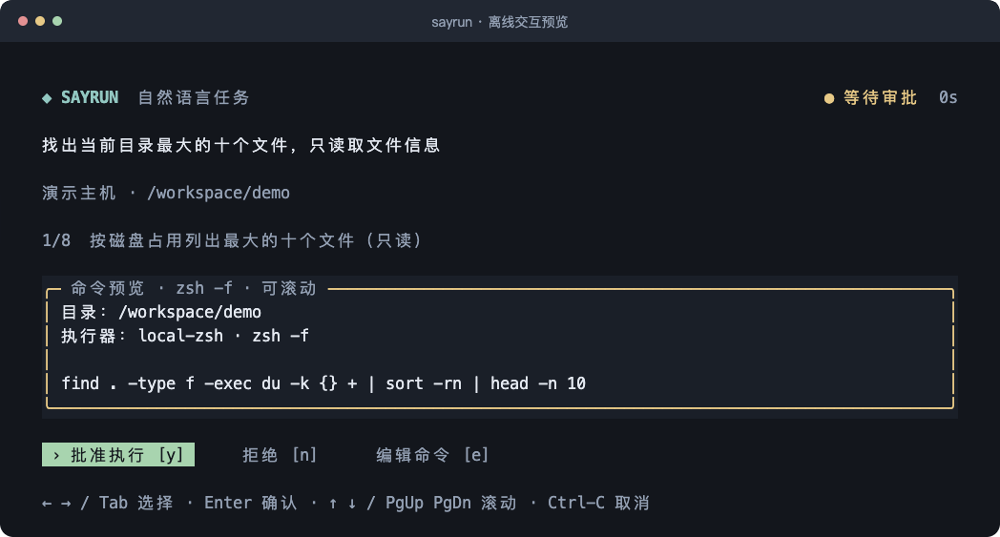

<div align="center">

# Sayrun

### 在熟悉的终端里，用自然语言完成任务

在原来的命令行直接输入需求，查看 AI 提出的命令，逐条批准执行，再获得结果与结论。

**沿用现有 zsh 工作流，让命令执行过程清晰、可控、可回看。**

[安装使用](#安装使用) · [快速开始](#快速开始) · [功能特性](#功能特性) · [常见问题](#常见问题)

</div>

Sayrun 将自然语言任务接入现有 zsh 提示符。你可以直接描述想做的事，在同一个终端查看命令、编辑或批准执行，并查看输出和最终结论；任务结束后返回原来的 shell。

当前内置 DSH 后端，由 DSH 负责模型调用，Sayrun 负责交互、审批、本地执行和统一历史。

## 效果预览



*上图由项目实际的 OpenTUI 渲染器生成，使用演示任务和路径，未调用模型或执行命令。*

安装后可运行 `sayrun preview` 体验审批与编辑；预览无需配置模型凭证。

## 安装使用

### 环境要求

| 项目 | 要求 |
| --- | --- |
| 系统 | 已在 macOS / Apple Silicon 验证；Linux 和其他架构待验证 |
| 终端 | 交互式终端；自然语言输入集成需要 zsh |
| Node.js | 22 或更高版本 |
| DSH | 已安装、完成认证且位于 `PATH`；当前适配已验证的 `0.2.0-rc.2` / `sdk-minimal` |

Bun 和 OpenTUI 由 npm 依赖安装，无需额外全局安装 Bun。日常使用不需要 Python。

### 安装到本机

通过 npm 全局安装：

```zsh
npm install -g sayrun-shell
```

npm 包名为 `sayrun-shell`，安装后的终端命令为 `sayrun`。安装包包含构建后的 JavaScript，无需下载源码或手动构建。

### 启用终端集成

Sayrun 复用 DSH 已配置的凭证，无需重复配置 API Key。安装完成后执行：

```zsh
sayrun setup
```

`setup` 会展示修改计划，经确认后备份 zsh 配置文件，并写入终端集成。首次在交互式终端运行时，会自动进入已启用 Sayrun 的新 zsh，随后即可直接输入自然语言；`exit` 返回原终端。已经加载集成的终端运行 `setup` 会直接刷新当前集成。

脚本调用或使用 `--no-shell`、`--temporary`、`--zshrc` 时不会自动启动新 shell。也可以手动在当前交互式 zsh 中启用：

```zsh
eval "$(sayrun shell init zsh)"
sayrun doctor
```

终端集成只需配置一次，以后新开的 zsh 终端会自动加载。配置、历史和诊断等管理操作使用 `sayrun` 命令。

## 快速开始

### 直接输入需求

在原来的 zsh 提示符中直接输入，然后回车：

```text
帮我找出当前目录最大的十个文件，只读取文件信息
```

也可以尝试：

```text
检查这个项目的目录结构，并说明主要模块的职责
查看当前 Git 工作区的变更，帮我整理一份摘要
```

以上示例分别输入，每次发起一个任务。常规命令、别名、函数和多行命令继续交给 zsh；歧义输入会尝试分类，无法确定时询问你。

日常使用无需添加命令前缀。未启用终端集成，或希望明确发起任务时，也可以使用：

```zsh
sayrun ask "帮我找出当前目录最大的十个文件，只读取文件信息"
```

### 审批与查看结果

1. 查看任务、执行目录和完整命令。
2. 选择批准、拒绝，或先编辑命令；每条新命令都需要审批。
3. 查看命令输出和退出状态，必要时回答补充问题。
4. 阅读任务结论，返回 shell；新请求默认开启新会话。

| 按键 | 操作 |
| --- | --- |
| `y` / `n` | 批准 / 拒绝当前命令 |
| `←` `→` / `Tab`，再按 `Enter` | 切换并确认操作，默认选中批准 |
| `e` | 编辑命令；编辑后按 `Enter` 默认执行修改后的命令 |
| `Shift-Enter` / `Ctrl-S` | 编辑时换行 / 仅保存并返回审批 |
| `↑` `↓` / `PgUp` `PgDn` | 滚动命令预览 |
| `Ctrl-C` | 取消当前任务并恢复终端 |

## 功能特性

| 功能 | 能做什么 |
| --- | --- |
| 自然语言入口 | 在原有 zsh 提示符直接输入需求，回车发起任务 |
| 逐条命令审批 | 展示执行目录和命令，支持批准、拒绝、编辑后执行 |
| 终端交互界面 | OpenTUI 提供键盘选择、多行编辑、追问和滚动；也可切换纯文本模式 |
| 执行反馈 | 展示输出摘要、退出状态和 Markdown 结论，支持取消与超时限制 |
| 统一任务历史 | 按项目查看、搜索、重命名、固定、归档、导入和导出会话 |
| 基于历史继续任务 | 将可见历史作为上下文创建新分支，再提交新的请求 |
| 分层配置 | 支持用户配置、项目配置和命名配置组合，可查看生效值及其来源 |
| 后端扩展与诊断 | 内置 DSH，支持显式注册外部进程适配器，提供能力检查和环境诊断 |

### 回看与继续任务

```zsh
sayrun sessions
sayrun sessions search "构建失败"
sayrun sessions show <会话ID> --full
sayrun resume --last --prompt "根据刚才的结果，再检查一次"
sayrun sessions export <会话ID> --format markdown --output /tmp/task.md
```

当前 DSH 的继续任务方式是基于可见历史创建新分支；旧命令不会自动重放，后续执行仍需重新审批。

### 调整常用配置

```zsh
sayrun config show --effective       # 查看实际配置及来源
sayrun config set ui.mode plain      # 使用纯文本界面
sayrun config set ui.mode opentui    # 切回 OpenTUI
sayrun config set agent.max_commands 10
sayrun config set execution.timeout_seconds 60
sayrun backend list
sayrun backend check dsh
```

用户配置默认位于 `~/.config/terminal-agent/config.toml`，项目配置使用 `.terminal-agent.toml`；这些路径沿用旧版命名，以兼容已有配置和历史。涉及后端、模型、预算等字段时，需要先执行 `sayrun config trust .`。

## 常见问题

### 安装后为什么自然语言没有生效？

npm 安装提供命令行程序；直接输入自然语言需要 zsh 已加载终端集成。执行 `sayrun setup`，确认后会自动进入已启用的新 zsh；已加载集成时则刷新当前终端。通过 `sayrun shell status` 可以查看状态。使用 `--no-shell` 仅完成配置后，可打开新的 zsh 终端，或执行上面的 `shell init zsh` 命令立即启用。

`postinstall` 无法修改安装命令所在父 shell 的回车处理，因此自动配置和启用由 `sayrun setup` 完成。

如果手动关闭过，可用 `sayrun shell on` 开启；如果配置过仅显式触发模式，使用 `sayrun config set routing.mode auto` 恢复自动识别。未加载终端集成时，也可以通过 `sayrun ask "任务"` 使用。

### 命令会自动执行吗？

每条命令都需要你明确批准。默认执行器在本机启动独立的 `zsh -f -c`，不加载别名、函数或启动配置；不同命令之间不保留 `cd` / `export`。当前不支持需要交互输入的命令或后台任务，也没有提供操作系统沙箱。

### 需要哪些运行时？

Node.js 运行命令行入口，npm 安装的 Bun 运行 OpenTUI 界面，DSH 提供模型后端。使用者运行构建后的 JavaScript；TypeScript 和 `tsx` 用于开发，Python 仅用于终端和安装回归测试。

### 如何排查环境或认证问题？

先执行 `sayrun doctor`、`sayrun backend check dsh` 和 `sayrun auth status dsh`。默认检查不发送模型请求；需要在线验证时使用 `sayrun doctor --live`，可能产生模型用量。

### 如何卸载？

```zsh
sayrun shell uninstall --dry-run
sayrun shell uninstall
npm uninstall -g sayrun-shell
```

卸载集成会备份 zsh 配置并移除标记区块，已有配置和历史保留。
