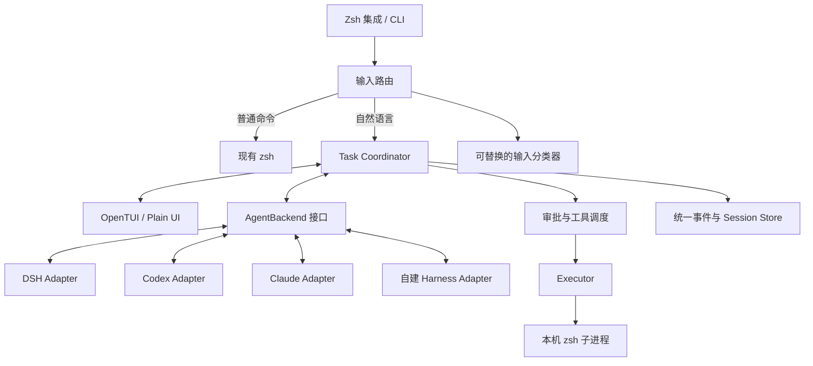

# Sayrun：可插拔后端与产品化设计（历史归档）

[文档索引](../README.md) · 分类：历史归档 · 状态：已归档

初稿：2026-10-16；归档：2026-10-19。

本文保留早期产品与后端边界的设计依据，正文同时包含归档时的实现状态和未实现提案，不再随当前实现更新。当前行为见[使用手册](../guide/usage.md)，模块职责见[架构文档](../development/architecture.md)，接口见[后端协议参考](../reference/backend-protocol.md)及 `src/contracts/`。后续方案应另建有明确状态的设计文档，不在本文追加路线承诺。

| 范围 | 归档时状态（2026-10-19） |
| --- | --- |
| npm 分发、setup、zsh 集成与诊断 | 已实现，包名为 `sayrun-shell` |
| DSH、审批执行、统一历史与迁移 | 已实现 |
| 同一 shell 多轮对话、DSH 原生恢复 | 已实现；恢复失败明确报错，可显式创建上下文分支 |
| 外部进程后端协议 | 已实现，需用户显式注册可信本地适配器 |
| Codex、Claude、自建模型循环 | 尚未内置 |
| SSH executor、Homebrew、独立可执行分发 | 后续提案 |

## 1. 设计结论

Sayrun 负责 shell 接入、终端交互、审批、执行和统一历史；Agent Backend 负责模型推理、上下文和 agent 循环。DSH 是第一个后端，后续接入 Codex、Claude 或自建 harness 不应修改 OpenTUI、审批流程和历史界面。

这里要区分两个替换层次：

- **替换 harness**：DSH → Codex → Claude Agent SDK → 自建 harness，走 `AgentBackend` 接口。
- **替换模型服务**：自建 harness 内选择不同 LLM 服务，走它自己的 `ModelProvider` 接口。模型 API 不能直接冒充一个具备会话、工具循环和取消能力的 harness。

默认采用 **host-tools 模式**：后端只能提出工具请求，命令由 Sayrun 在用户确认后执行。保留后端原生执行模式的扩展位置，但不在 V1 同时实现两套执行语义。

## 2. 保留的体验与范围

以下是已确认的产品行为，后端切换后也必须成立：

1. 在现有 zsh 中自动区分命令和自然语言，明确命令原样提交；续行、alias 和其他 ZLE 插件继续工作。
2. agent 全程在当前终端，后台不弹出 DSH 或其他后端界面。
3. 每个新任务默认新建会话；任务完成后面板退出，留下步骤摘要与最终结论。继续旧任务需要显式恢复。
4. 批准在最左边，默认选中且绿色背景；批准、拒绝、编辑都能通过方向键和 Tab 选择。
5. 编辑框 Enter 批准并执行修改后的命令，Shift-Enter 换行，Esc 放弃编辑；Ctrl-S 只保存并返回审批。
6. 问题回答只是文本，不代表批准命令；粘贴文本和换行不触发执行。
7. 步骤只保留命令、输出摘要和状态；结论用终端 Markdown 展示。
8. 拒绝结束任务；Ctrl-C 取消并恢复终端。

V1 面向 macOS / Linux 的交互式 zsh，Linux 和各架构必须经过发布测试后才标记支持。先做本机执行；用户在 SSH 登录后的远端安装工具，可在那个远端 shell 内使用。由本地工具直接控制 SSH 目标属于后续功能，不能把“本地执行 ssh 命令”当作完整的远端执行支持。

## 3. 架构和职责



| 模块 | 拥有的职责 | 不接触的细节 |
| --- | --- | --- |
| Shell Integration | 接管 Enter、保留 shell 语义、启停与冲突检测 | 厂商模型参数、会话文件格式 |
| Router / Classifier | 本地规则、歧义分类、低置信度人工选择 | 任务执行、命令改写 |
| Coordinator | 单次任务状态、预算、事件排序、工具请求与取消 | DSH / Codex 原始事件名 |
| UI | 展示统一状态、收集操作与输入 | JSON-RPC、SDK、模型认证 |
| AgentBackend | 启动 harness、会话、消息、工具请求、结果回传 | 直接读键盘、直接操作 UI |
| Tool Broker / Executor | 确认后的准确命令、执行目录、目标、输出与超时 | 推理和规划下一步 |
| Session Store | 统一会话、检索、导出、恢复映射 | 依赖单一厂商日志才能展示历史 |

Executor 同样保留接口边界：V1 只有 `local-zsh`，以后增加 SSH executor 时，不必替换 agent。命令审批必须展示实际执行目标和目录。

### 3.1 接入路径与能力分级

| 后端 | 计划接入方式 | 评审时的状态与限制 |
| --- | --- | --- |
| DSH | `sdk-minimal` 的 stdio JSON-RPC + 自定义桥接插件 | 使用 `session/resume` 原生恢复；本机 DSH 已通过离线跨进程历史验证 |
| Codex | 优先本地 `codex app-server`，映射会话、事件与自定义工具 | 官方提供嵌入协议；动态工具接口标记为 experimental，须固定兼容版本并验证工具限制 |
| Claude | 优先 Claude Agent SDK + 自定义工具 / MCP bridge | 官方提供程序化 agent 与权限接口；尚未实现适配器 |
| 自建 harness | 实现相同契约；后端内部持有 LLM provider 与工具循环 | 设计预留，不要求复制 DSH 协议 |
| Codex / Claude 桌面 App | 仅在存在公开、可验证的控制接口时增加适配器 | 不承诺复用桌面 App 的聊天、登录或额度；不以自动点击 App 作为默认通信方案 |

Codex app-server 支持会话、流式事件和审批；其 `dynamicTools` / `item/tool/call` 为实验接口。[官方文档](https://learn.chatgpt.com/docs/app-server)

Claude Agent SDK 提供 agent 循环、自定义工具和权限控制。`canUseTool` 可能被提前允许的规则跳过，不能把它当作“所有工具一定经过审批”的保证。[SDK 概览](https://code.claude.com/docs/en/agent-sdk/overview)、[权限文档](https://code.claude.com/docs/en/agent-sdk/permissions)、[自定义工具](https://code.claude.com/docs/en/agent-sdk/custom-tools)

这些资料证明存在接入入口，不代表适配器已经符合本产品的执行契约。准入分三档：

- **完整支持**：能限制工具集合，所有执行经 host broker，支持编辑后执行、提问、取消和统一事件。
- **受限支持**：例如只支持后端原生审批，不能准确替换待执行命令；能力要明确展示，不能静默隐藏编辑行为或伪装成完整支持。
- **不可用**：依赖、版本或必需能力不满足，任务开始前报错；不自动改用其他服务发送用户数据。

V1 可以列出受限适配器的诊断，但不通过它执行任务；后续明确支持原生执行模式后再开放对应能力。完整支持所需能力在任务前检查，不在执行到中途才发现无法编辑或提问。

仅设置 system prompt 无法证明后端不会使用原生 Bash、文件写入、其他 MCP 或委派工具。每个适配器都必须验证有效工具集合；不能限制时，不进入 host-tools 档。该限制是产品协议约束，不等于对第三方本地进程实现了 OS 沙箱。

### 3.2 AgentBackend 契约草案

以下为 TypeScript 设计签名，具体类型在实现时独立成包；内部使用接口，外部适配器通过进程协议实现相同语义。

```ts
type BackendCapabilities = {
  hostTools: boolean;
  commandEditing: boolean;
  userQuestions: boolean;
  cancellation: 'native' | 'process';
  resume: 'native' | 'context-only' | 'none';
  ephemeral: boolean;
  classify: boolean;
  modelDiscovery: boolean;
  usage: boolean;
};

type EventMeta = {
  id: string;
  runId: string;
  timestamp: string;
};

type BackendEvent = EventMeta & (
  | { type: 'status'; phase: 'thinking' | 'checking'; message?: string }
  | { type: 'message'; text: string; final: boolean }
  | { type: 'command.requested'; requestId: string;
      command: string; description: string; cwd: string; targetId: string }
  | { type: 'question.requested'; requestId: string; question: string }
  | { type: 'usage'; inputTokens?: number; outputTokens?: number; cost?: number }
  | { type: 'run.ended'; reason: 'completed' | 'cancelled' | 'limit' | 'failed' }
);

type HostReply =
  | { requestId: string; kind: 'command'; approved: false; reason: string }
  | { requestId: string; kind: 'command'; approved: true;
      executionId: string; command: string; cwd: string; targetId: string;
      output: string; exitCode: number | null; signal: string | null;
      timedOut: boolean; cancelled: boolean; truncated: boolean }
  | { requestId: string; kind: 'answer'; text: string; commandApproval: false }
  | { requestId: string; kind: 'error'; code: string; message: string };

interface BackendSession {
  nativeRef?: string;
  run(input: { runId: string; prompt: string; signal: AbortSignal }): AsyncIterable<BackendEvent>;
  reply(result: HostReply): Promise<void>;
  interrupt(): Promise<void>;
  close(): Promise<void>;
}

interface AgentBackend {
  id: string;
  apiVersion: 1;
  probe(): Promise<{
    available: boolean;
    version?: string;
    capabilities: BackendCapabilities;
    diagnostics: string[];
  }>;
  connect(options: {
    cwd: string; targetId: string; model?: string;
    resumeRef?: string; initialContext?: string; ephemeral: boolean;
  }): Promise<BackendSession>;
}
```

契约中的 `message` 是面向用户的说明和回答，不要求后端暴露隐藏推理。token / 费用未知时省略，UI 不显示虚构的零费用。

`command.requested` 表示提案，没有执行副作用。Coordinator 校验后等待用户操作，再把实际执行结果通过 `reply` 交回；编辑后的 `command` 必须返回模型。问答走独立类型。

并发工具请求由 Coordinator 排队；V1 每次只审批并执行一条。重复的 `requestId` 复用已记录结果，不能重新执行；过期、取消后的请求拒绝。网络重试与命令重试分别处理，后端断线不能导致已执行命令重放。

`targetId` 必须匹配本次配置的执行目标，不能由模型请求自行切换机器。后端的完成事件不能跳过仍在执行的 host 工具；Coordinator 先完成或中断工具并记录真实状态，再结束 run。

### 3.3 传输与适配方式

- DSH 适配器的 composition、RPC 和桥接插件位于 `src/backends/dsh/`。Unix Socket、随机令牌和 `/execute` 属于这个适配器的桥接实现，不成为所有后端的强制协议。
- Codex 适配器映射 app-server 的原生握手、请求和通知，不能直接套用当前 DSH 的 `LineRpc`。例如其文档中的协议省略 `jsonrpc` 字段，且握手与方法名不同。
- Claude 适配器在 SDK worker 中转换事件和自定义工具调用；SDK 的原生工具必须按准入规则收敛。
- 第三方适配器 V1 使用本地进程插件：manifest 声明协议版本、可执行文件、参数与环境变量白名单；stdio 只传 JSONL 协议，诊断走 stderr。Coordinator 用 argv 启动，避免拼接 shell 字符串。
- 运行时 `hello` / `probe` 握手返回实际能力；manifest 的静态声明不能单独作为能力证明。插件加载是执行本机代码，应由用户显式注册。

分类器独立成 `IntentClassifier`，输入为原始文本和有限的命令名称提示，输出为 route / confidence。可以复用后端的无工具分类能力，也可使用独立模型。后端不支持时退回人工选择；不能为了分类给模型授予执行工具。

## 4. 安装、首次使用和卸载

### 4.1 分发顺序

1. **开发版**：保留仓库安装和手动 source，适合当前迭代。
2. **首个可分发版本**：发布 npm 包，安装包暴露稳定的 `sayrun` 可执行文件，依赖固定版本的 Bun / OpenTUI；用户无需把仓库路径写进 zshrc。
3. **稳定版**：提供按系统架构打包的安装包和 Homebrew 分发，包含所需运行时与原生资产；版本切换应能回退。先验证 OpenTUI FFI 和资源加载，再承诺独立包不需要 Node / Bun。

后端单独安装；使用 DSH 不要求安装 Codex、Claude。Sayrun 已通过 npm 包 `sayrun-shell` 分发，也可从源码构建 tarball。安装 Sayrun 不会安装或登录 DSH，当前没有 Homebrew 分发。

### 4.2 首次使用流程

```text
安装发布包
  → sayrun setup
  → 检测终端、zsh、可用后端和冲突
  → 选择默认后端，显示其认证状态
  → 初始化用户配置和存储
  → 安装 shell 集成，或给出临时启用命令
  → sayrun doctor
  → 输入第一条自然语言任务
```

`setup` 展示将修改的文件，为 zshrc 创建备份，只管理自己的标记区块，重复执行幂等。推荐添加：

```zsh
# >>> sayrun >>>
if command -v sayrun >/dev/null 2>&1; then
  eval "$(sayrun shell init zsh)"
fi
# <<< sayrun <<<
```

`shell init zsh` 必须是快速、确定性的本地脚本生成，不启动 agent、不访问网络、不把用户输入拼入输出；只有这段程序自身生成的初始化代码被 eval。

保留旧版 `ta` 简写；初始化时检查它是否已被占用，冲突时保留已有定义并使用 `sayrun`。检测 autosuggestions、syntax-highlighting 和 accept-line 包装链；不修改其他插件的代码。

`doctor` 默认只检查本地能力；`doctor --live` 才发送最小模型探测请求，并明确它可能产生用量。后端暂不可用时，普通 shell 命令继续工作，进入 agent 时给出诊断。

临时启停：`sayrun shell off` / `sayrun shell on` 作用于当前 shell；这些子命令由 shell wrapper 处理，因为普通子进程无法修改父 shell 的开关。`sayrun shell status` 展示当前启用状态。现有 `terminal-agent-off` 保留兼容入口。

卸载 shell 集成使用 `sayrun shell uninstall`，只移除标记区块。二进制通过原安装渠道卸载，历史和配置默认保留；清理数据需要独立的显式命令。

### 4.3 更新

`sayrun version` 展示程序、运行时、适配器和协议版本。`sayrun update --check` 只检查；实际更新按原安装渠道执行，不在 shell 启动或任务中自动升级。

升级前检查配置和会话 schema；迁移创建备份、原子提交，失败保留旧版本可用。后端版本不兼容时报告支持范围，不能靠忽略未知事件继续执行命令。

## 5. 命令设计

命令 `sayrun` 和兼容简称 `ta` 使用同一套解析器。自然语言仍以直接在 zsh 输入为主要入口；管理命令由确定性代码处理，不交给模型解释。认证、在线探测和更新仅在相应显式操作时访问网络。

### 5.1 日常入口

| 命令 | 行为 | 阶段 |
| --- | --- | --- |
| `sayrun ask "查一下这个域名"` | 新建任务，完成即退出 | V1 |
| `sayrun "帮我找最大的文件"` | 兼容现有自然语言快捷入口 | V1 |
| `sayrun -- "history"` | 强制把后续内容当作任务，避免与子命令冲突 | V1 |
| `sayrun ask --backend codex "检查构建失败"` | 只对本次任务切换后端 | V1 接口；后端须已适配 |
| `sayrun ask --profile ops "检查服务"` | 使用命名配置组合 | V1 |
| `sayrun resume --last --prompt "再检查一下 AAAA 记录"` | 继续当前项目最近任务，完成后退出 | V1，取决于后端恢复能力 |
| `sayrun resume <id>` | 展示旧任务和输入框；用户提交新请求后才开始模型调用 | V1 |
| `sayrun sessions` | 在终端浏览当前项目历史，退出后返回 shell | V1 |
| `sayrun preview` | 模拟审批、编辑、步骤和结论，不调用模型 | 已有，保留 |
| `sayrun doctor` | 检查安装、后端版本、配置、存储与 shell 集成 | 已有，扩充 |

管理子命令是保留字，命中后始终按管理命令解析；未知的单个英文词提示拼写和 `sayrun --` 用法，不静默产生模型请求。兼容的自然语言快捷入口只接受明显的自然语言参数，推荐文档统一展示 `sayrun ask`。

当前 `sayrun` / shell 兼容简称 `ta` 无参数会提示输入一次任务，完成后返回 shell；不进入常驻聊天。未来历史选择器应是临时终端界面，选择后进入查看或恢复；完成任务仍自动退出。

### 5.2 后端与配置

| 命令 | 行为 |
| --- | --- |
| `sayrun backend list` | 展示已注册后端、可用状态、能力与版本 |
| `sayrun backend info <name>` | 查看协议、模型参数、认证方式和受限能力 |
| `sayrun backend check <name>` | 本地握手与能力检测；`--live` 才访问模型 |
| `sayrun backend add <name> --manifest /absolute/path/adapter.json` | 显式注册第三方适配器；后续阶段开放 |
| `sayrun backend remove <name>` | 注销适配器，保留历史；内置适配器使用禁用配置 |
| `sayrun backend use dsh` | 修改用户配置的默认后端；不影响正在运行或恢复中的任务 |
| `sayrun auth status [backend]` | 展示认证状态和来源，不显示凭证 |
| `sayrun auth login <backend>` | 使用适配器支持的官方认证入口；不支持时给出环境变量配置说明 |
| `sayrun config show --effective` | 展示当前项目生效配置及来源，屏蔽凭证 |
| `sayrun config get/set <key> [value]` | 查询 / 修改用户配置；`--project` 只写项目允许字段 |
| `sayrun config edit` / `sayrun config validate` | 用 `$EDITOR` 编辑 / 校验配置 |
| `sayrun profile list` | 查看命名配置；`--profile` 只影响本次任务 |

V1 不做插件市场或自动安装任意包。`backend use` 只变更默认字段；显式 `--profile` 或项目配置覆盖时，输出说明当前目录为何仍使用其他后端。

## 6. 配置模型

采用带 schema 版本的 TOML。常用设置有类型、默认值和来源，后端专属字段放在各自命名空间。

```toml
schema_version = 1

[agent]
backend = "dsh"
max_commands = 8
max_steps = 12
max_questions = 5
active_timeout_seconds = 180

[routing]
mode = "auto"                      # auto | local | explicit
classifier = "backend"             # backend | 独立分类器名称
confidence_threshold = 0.9
timeout_seconds = 12
on_ambiguous = "ask"

[ui]
mode = "opentui"                   # opentui | plain
language = "zh-CN"
color = "auto"                     # auto | always | never
output_preview_lines = 12

[approval]
default_selection = "approve"
editor_enter = "execute"           # execute | save

[execution]
executor = "local-zsh"
shell = "/bin/zsh"
timeout_seconds = 30
max_output_bytes = 65536

[history]
enabled = true
default_scope = "project"
auto_gc = false
retention_days = 30                # 仅在显式 GC 或启用 auto_gc 后应用
max_total_mb = 1024
store_command_output = true
include_classifier = false         # 默认列表隐藏分类记录，不等于不落盘

[backends.dsh]
binary = "dsh"
model = "deepseek-flash"
api_key_env = "DEEPSEEK_API_KEY"

[backends.codex]
binary = "codex"
# model 未设置时由适配器发现或采用其默认；不硬编码跨后端通用模型名。

[backends.claude]
adapter = "claude-sdk"

[profiles.ops.agent]
max_commands = 12

[profiles.ops.execution]
timeout_seconds = 60
```

生效顺序从低到高：内置默认 → 用户配置 → 显式命名 profile → 当前项目允许配置 → 环境变量 → CLI 参数。`--backend` 切换时只读取该后端命名空间，不能把 DSH 模型名传给 Codex。

项目配置固定为项目根目录 `.terminal-agent.toml`，只读取最近的 Git 根目录；非 Git 项目使用任务目录，不向任意父目录搜集配置。默认允许 UI、语言和项目上下文；选择已注册后端、增大执行预算等需要用户在本机 `sayrun config trust .` 后才生效。

可执行文件路径、外部插件、凭证引用、数据路径、自动清理和审批策略仅允许用户配置 / 环境变量 / CLI 设置，项目配置不能通过这些字段执行代码或扩大授权。信任绑定目录 realpath 和受保护配置内容摘要，内容改变后重新评估。

密钥采用环境变量名、系统凭证库引用或厂商官方认证存储；配置中不写明文密钥。`config show` 只展示引用和是否可用。不会直接读取桌面 App 的内部 token 来实现“复用登录”。具体登录与用量规则由适配器说明。

显式 `resume` 默认沿用记录中的后端、模型、目录和执行配置快照，新的用户硬性限制仍优先。同一 shell 自动续接使用当前目录与当前生效配置，并按后端分别维护会话；每轮生效配置写入新 run，不把旧后端的上下文静默发给另一个服务。

`NO_COLOR`、终端能力与 `--no-color` 共同影响展示；颜色选项不允许未过滤的模型 / 命令 ANSI 序列直通终端。

### 6.1 环境变量兼容

保留现有 `TERMINAL_AGENT_UI`、`TERMINAL_AGENT_DSH_BIN`、`TERMINAL_AGENT_MODEL`、`TERMINAL_AGENT_CREDENTIALS` 等，并在 `config show --effective` 中标出来源。旧 `TERMINAL_AGENT_MODEL` 只作为 DSH 模型兼容项，其他后端使用其专属配置。

**现有 `TERMINAL_AGENT_HOME` 表示 DSH 运行目录，不把它重新解释成整个产品的数据根目录。** 新增 `TA_HOME` 供统一搬迁配置、数据、状态和缓存，子目录分别为 `config/`、`data/`、`state/`、`cache/`、`runtime/`。旧变量继续只覆盖 DSH 的 home，迁移时给出诊断。

## 7. 历史会话与存储

### 7.1 三种 ID

- `sessionId`：用户看到的逻辑会话，可含多轮自动续接与显式恢复。
- `runId`：一次用户请求及随后的 agent 工作；本次完成即退出面板。
- `nativeRef`：适配器保存的 DSH sessionId / Codex threadId 等，不作为通用会话 ID。

加载 zsh 集成后，同一 shell 实例、项目和后端默认沿用活跃 session，每次提问创建新 run。普通 shell 命令不切断会话；新 zsh（包括嵌套和 `exec zsh`）独立，重新 source 集成保留当前会话。同一 Git 项目的子目录共用会话，项目间分别保存绑定。`sayrun ask --new "任务"` 新建并切换活跃会话。未加载集成的独立调用默认新建；关闭历史时不自动续接。`--last` 默认限定当前机器与项目，找不到时展示选择器，不自动恢复另一个目录的最近任务。

### 7.2 数据目录

用户安装采用 XDG 风格目录，macOS 也保持相同产品规则；变量设置时遵循对应的 XDG 路径：

```text
~/.config/terminal-agent/config.toml
~/.local/share/terminal-agent/
  installation.json                # 本机安装身份，不依赖可变主机名
  sessions/<sessionId>/
    meta.json                       # 标题、标签、目录、状态、后端映射
    events.jsonl                    # 统一事件，追加写
    outputs/<executionId>.txt       # 有界执行输出，无终端控制码
    context/<runId>.json            # 恢复 / 分支所用的显式上下文
  index.sqlite                      # 可重建的检索索引
  backends/<backend>/<profile>/     # 仅放本工具管理的厂商运行数据
~/.local/state/terminal-agent/logs/
~/.cache/terminal-agent/
$XDG_RUNTIME_DIR/terminal-agent/    # 临时 IPC；缺省使用私有临时目录
```

`events.jsonl` 和输出文件是任务内容来源，索引损坏可以重建；`meta.json` 是可原子更新的用户元数据。使用稳定机器身份 + 项目 realpath / Git 根目录归类，不把裸路径字符串当跨机器身份。

每个事件至少记录 schemaVersion、sessionId、runId、seq、timestamp 和 type。命令记录 proposedCommand、executedCommand、cwd、targetId、用户决策来源（批准按钮 / 编辑后 Enter）、executionId、开始结束时间、退出状态及输出引用。需要记录的执行结果必须先持久化，再发回后端。

原始厂商数据是恢复辅助数据；日常历史展示不读取厂商私有格式。raw 协议诊断默认关闭，开启时也过滤认证字段；统一历史不保存键盘逐键记录。

### 7.3 历史命令

| 命令 | 行为 | 阶段 |
| --- | --- | --- |
| `sayrun sessions list [--all] [--backend dsh] [--status failed]` | 默认列出当前项目任务；`--all` 跨项目 | V1 |
| `sayrun sessions show <id>` | 展示结论、步骤、命令与输出；可用 `--full` 展开记录 | V1 |
| `sayrun sessions search "NXDOMAIN"` | 检索请求、结论和已保存输出；可选 `--all` | V1 |
| `sayrun sessions rename <id> "UAT 域名排查"` | 修改用户标题，记录仍保留 | V1 |
| `sayrun sessions pin/unpin <id>` | 固定 / 取消固定，固定会话不参与自动清理 | V1 |
| `sayrun sessions archive/restore <id>` | 归档 / 恢复显示，不删除数据 | V1 |
| `sayrun sessions export <id> --format markdown` | 导出可读记录；不执行历史命令 | V1 |
| `sayrun sessions export <id> --format json` | 导出版本化的统一记录，含受管理输出附件清单 | V1 |
| `sayrun sessions delete <id>` | 明确确认后删除本工具管理的数据；支持 `--yes` | V1 |
| `sayrun sessions gc --dry-run` | 展示按天数和容量拟清理列表，`--apply` 才执行 | V1 |
| `sayrun sessions reindex` | 从文件恢复索引 | V1 |
| `sayrun sessions fork <id> --backend codex --context summary` | 建立有来源关联的新会话，跨后端使用可见上下文 | 后续 |
| `sayrun sessions import /path/export.json` | 导入统一记录，只读起步，不执行其中工具调用 | 后续 |

`--all` 默认仍只含任务；`--include-classifier` 才显示分类记录。短 ID 必须唯一，不唯一时列出候选，不能任意选一个。列表显示标题、时间、后端、项目、最近 run 状态、命令数与恢复能力。

归档和固定是独立属性。删除和 GC 跳过活动会话；GC 默认手动，自动清理需用户启用，排除固定会话。导出包含本地路径和命令结果，应支持预览与脱敏；脱敏不能被描述成百分百消除敏感信息。

删除只处理本工具拥有的文件。厂商会话若在外部官方 home 中，只断开关联并明确残留位置，不遍历或删除用户其他 Codex / Claude / DSH 会话。适配器需要声明 native 数据是否受管理、是否支持删除以及实际清理结果；没有这些能力就不能宣称“全部记录已清除”。

### 7.4 恢复、回放与跨后端

**查看 / 回放不执行任何命令。** 恢复是发送一个新的用户请求，不能重放旧工具调用。

- 后端支持 native resume 且引用存在：加载原生会话，再开启新 run。
- 原生恢复失败：明确报错，不自动提交替代请求；用户可用 `--context-only` 显式创建可见上下文分支，或用 `ask --new` 新建对话。后端只支持 context-only 时展示说明并创建分支，保留 parentSessionId。
- 后端更换：走 fork，而不是将 DSH 原生日志直接交给 Codex。可迁移用户消息、执行事实、已有结论；隐藏推理与厂商内部状态不承诺迁移。
- 原生会话的上下文压缩由后端负责，DSH 的 sdk-minimal 已启用自动 compaction，sayrun 不重复实现摘要压缩。显式上下文分支显示将发送的范围，按预算选择结论与关键执行事实；浏览历史不调用模型。
- 目录不存在、目标机器不同或模型不可用：恢复前提示处理，不静默换目录、换目标或换服务。
- 普通命令在每次独立 shell 中运行；恢复上下文不等于恢复上次的进程、环境变量、cd 状态或终端进程。

`history.enabled=false` 仅表示不保存本工具的任务内容；仍需最小的运行锁和执行状态用于避免重复执行。只有适配器能关闭原生持久化时才允许 `--ephemeral` 并宣称不保存会话内容，否则在开始前说明不支持。两者均不能保证模型服务端不留存数据。

## 8. 状态、取消和异常

run 状态：`starting → thinking ↔ awaiting_approval / awaiting_input / executing → completed / stopped / cancelled / limited / failed / interrupted`。`completed` 只表示 agent 结束，不代表用户环境已达到业务目标；结论需要说明验证事实。

统一错误包括 backend_missing、auth_required、backend_incompatible、capability_missing、protocol_error、model_timeout、command_timeout、session_locked、session_not_found、storage_error。UI 显示可操作原因，详细诊断留在本地日志。

关键规则：

- 用户等待期间暂停 agent 的 active budget；进程握手、模型等待和执行计入运行时间。单条命令有独立超时。
- Ctrl-C 先发适配器的原生中断，必要时终止本次子进程组；关闭等待中的工具请求，清理 IPC，恢复终端。
- 同一会话只有一个写入进程，使用进程锁与递增 seq；不同会话可以在不同终端并行。
- 执行前追加并刷盘 `execution.started`，结束后记录结果。崩溃时只有 started 没有 result，标为 interrupted / outcome unknown，**不自动重试**。
- 该方案提供重复请求防护，不承诺命令副作用恰好一次。进程已经执行但结果未落盘时，需要新任务检查实际状态。
- 写入失败在执行前阻止命令；执行后落盘失败则显示已执行但记录失败，保留诊断并停止后续自动动作。
- 输出摘要只影响 UI；返回模型的内容有单独的字节上限，截断状态必须一致可见。
- 非 TTY 的 ask 不等待无法完成的审批；V1 明确拒绝。`sessions list/show/export --json` 等只读管理命令支持管道。

CLI 退出码建议：0 正常完成；1 运行失败；2 参数 / 配置错误；3 用户拒绝；4 预算或输出上限导致任务未完整结束；5 后端或认证不可用；130 用户取消。命令自己的退出码写入步骤记录；一次命令失败而后续补救成功，不直接等同整个任务失败。

## 9. 早期原型的迁移记录

以下是早期 JavaScript 原型的迁移对应关系，当前 TypeScript 结构见 [架构文档](../development/architecture.md)。

| 早期代码 / 数据 | 迁移后的职责 |
| --- | --- |
| `src/agent.mjs` 中 DSH 的创建与原始事件分支 | `backends/dsh/` 适配器 |
| `src/agent.mjs` 中审批、预算、取消与执行顺序 | `src/application/run-task.ts` |
| `src/dsh.mjs`、`src/rpc.mjs`、`dsh/terminal-tool.mjs` | DSH 专属运行时与桥接 |
| `src/classify.mjs` | 分类策略接口 + DSH 分类适配 |
| `src/ui*.mjs`、`src/transcript.mjs` | 保留展示层，消费统一类型 |
| `src/execute.mjs` | `src/execution/` |
| 项目 `.runtime/dsh/sessions` | 通过显式迁移导入统一索引，保留原生恢复映射 |

旧记录迁移使用 `sayrun migrate --from /absolute/path/.runtime/dsh --dry-run`，确认后 `--apply`：校验格式、备份、逐条转换并记录来源。按来源路径 + nativeId / 内容摘要去重，重复执行不重复导入；保留无法识别的数据，不删除旧目录。

优先为旧会话提供查看与检索。迁移记录保留 context-only 标记；原生恢复需要当前 SDK 与仍存在的原生历史，缺失时明确失败。迁移和用户存储就绪后，运行时不再依赖代码仓库位置。

## 10. 实施顺序和验收

### P0：后端边界与现有体验

抽出契约、统一事件、Coordinator 和 DSH adapter；用不依赖 DSH 的 fixture backend 跑同一套流程。现有终端体验、批准顺序、编辑后 Enter 执行和最终结论保持一致。

验收：UI / 执行器 / 历史核心不 import DSH；替换 fixture 无需修改 UI；问题答案不批准命令；重复请求不重复执行；取消能收回进程并恢复 zsh。

### P1：可安装与统一历史

引入用户目录、TOML、setup / shell / doctor、统一事件存储及历史查看、搜索、导出、归档、删除、GC 与迁移。先有可靠的离线历史，再做原生恢复。

验收：移动 / 删除开发仓库后用户安装可运行；source 幂等、开关兼容实际 zsh 插件；配置来源可解释；索引可重建；删除不影响其他厂商会话；失败迁移不损坏旧记录。

### P2：第二个真实后端

建议先做 Codex app-server 适配器，用第二套协议验证抽象。完成 host-tools 准入实验，固定后端版本，验证取消、工具限制、编辑、提问与会话恢复；不满足时标记受限，必要时保留 MCP bridge 路线。

验收：同一组功能用例在 DSH / Codex 上成立；不能只验证“问一句拿到回答”。用例包括修改命令后模型收到准确执行值、后端试图调用其他工具、已执行后断线、用户拒绝、resume 引用失效等。

### P3：Claude、自建 harness 与扩展分发

复用契约与测试接入 Claude SDK、自建 harness；再开放外部适配器、跨后端 fork、独立安装包与 SSH executor。桌面 App 直接接入独立评估，不作为 CLI / SDK 适配的隐含承诺。

## 11. 建议评审的决策

以下均给出默认建议，不要求本轮逐项回答：

| 决策 | 建议 |
| --- | --- |
| 谁拥有命令执行 | V1 全部由 Sayrun 执行，后端提供规划与工具请求 |
| 第二个后端 | Codex app-server，先以能力准入实验验证 |
| 后端原生执行 | 暂缓，避免编辑、审批和目标语义不一致 |
| 历史归属 | 统一产品历史 + 后端原生引用，文件为内容来源，索引可重建 |
| 继续任务 | 同一 shell、项目和后端自动续接；独立调用支持显式 resume，任务结束返回提示符 |
| 跨后端迁移 | 创建带来源的新分支，只迁移可见上下文 |
| 默认存储 | 用户目录；兼容旧 DSH home，不继续绑定仓库 |
| 默认清理 | 手动 GC，自动清理由用户开启 |
| 安装顺序 | 先 npm 可分发版本，再做独立包与 Homebrew |
| 项目配置 | 字段白名单与本机信任，不能注册插件或覆盖凭证路径 |
| 桌面 App 的登录与额度 | 不承诺复用，按官方接入接口与认证规则逐后端验证 |

## 12. 资料与验证边界

本文记录 Sayrun 的产品边界与后续接口提案。以下外部资料用于评估尚未实现的适配器，不代表已完成兼容验证：

- [Codex app-server 官方文档](https://learn.chatgpt.com/docs/app-server)：支持程序化会话和事件；动态工具接口属于实验能力。
- [Claude Agent SDK 官方概览](https://code.claude.com/docs/en/agent-sdk/overview)、[自定义工具](https://code.claude.com/docs/en/agent-sdk/custom-tools)、[权限](https://code.claude.com/docs/en/agent-sdk/permissions)：提供接入入口，适配器仍须验证有效工具集合与版本。

npm 分发、旧记录迁移和 DSH 原生恢复已实现；其他真实后端、SSH 执行器及独立二进制分发仍属于后续工作。发布过程见[发布文档](../development/releasing.md)。
